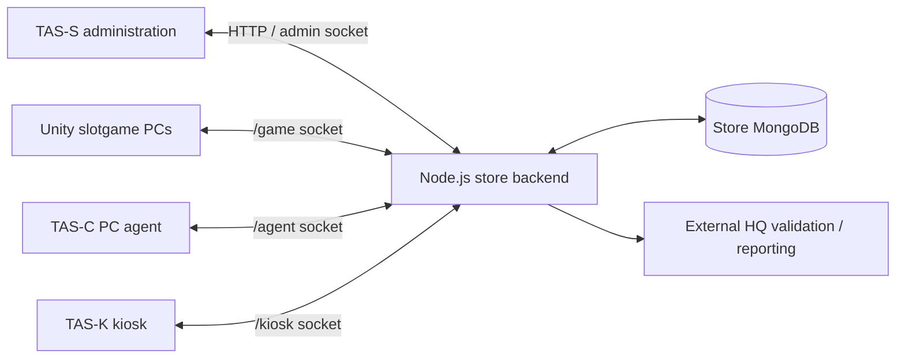

# slot_game_backend
## Architecture

slotgame uses a hybrid gameplay model  Unity runs reels, normal-win selection, videos, sounds and bonus presentation.
The server authenticates devices, supplies settings and machine time, persists gameplay results, maintains accounting and authorizes jackpot resservations.



TAS-K uses the store database through the backend. Its hardware/UI application and the TAS-C agent are separate components. HQ is a separate service; this repository implements outgoing HQ calls, not the HQ database/service itself.

## Prerequisites and configuration

- Node.js 22 or newer, as declared in `package.json`.
- MongoDB configured for transactions through a replica set or sharded deployment.
- Unity project with the socket/gameplay scripts and required scene/reel/video resources.
- Registered store, administrator, game, machine, card and enrolled device credentials.

Configure the backend `.env` using the fields validated by `src/config.js`:

| Variable | Purpose |
|---|---|
| `MONGODB_URI` | MongoDB connection, including replica-set configuration where applicable |
| `MONGODB_DATABASE` | Store database name |
| `STORE_ID` | Store scope used by operator provisioning |
| `JWT_SECRET` | Administrator signing secret, at least 32 characters |
| `HOST`, `PORT` | Listen address and port; default port is 5000 |
| `CORS_ORIGINS` | Allowed browser origins |
| `NODE_ENV` | Development, test or production |
| `HQ_VALIDATION_REQUIRED`, `HQ_URL`, `HQ_API_KEY` | External HQ entitlement and reporting configuration |

Production configuration requires HQ validation and an HTTPS HQ URL. Do not put real credentials in README examples or commit them.

### Initial provisioning without demo seed data

Set `BOOTSTRAP_STORE_NAME`, `BOOTSTRAP_OWNER_USERNAME`, `BOOTSTRAP_OWNER_PASSWORD` (12–256 characters), and optionally `BOOTSTRAP_TIMEZONE`. The existing command is:

```powershell
node scripts/provision.js
```

The current `package.json` does not contain a `provision` npm alias, so use the direct command. Provisioning creates the store, hashed owner credentials and audit entry atomically; it refuses to overwrite an existing store. It does not create demo devices, cards or games.

Start the backend:

```powershell
npm start
```

Log in with `POST /api/v1/auth/login`, then use the returned Bearer access token on `/api/v1/stores/:storeId` endpoints:

1. `POST /games`: register `seven_slot` and create its initial settings.
2. `POST /machines`: register the PC and machine number.
3. `POST /devices`: enroll Unity as `GAME_CLIENT`, the agent as `DEVICE_TAS_C`, and kiosk as `DEVICE_TAS_K`, each with its own secret.
4. `POST /cards`: register the player's card.
5. Assign the card to the machine and establish valid usage time using the time operations. The socket operation `time.session.start.v1` supports this; the current HTTP routes expose paid/service/maintenance additions and pause/resume/delete rather than a separate start route.

Administrative writes need a unique `eventId` or `idempotency-key`, a reason where required, and any expected version required by the handler. See `src/modules/backend.js` for each payload schema.

Configure Unity's `SocketConnection` component with the backend URL, `storeId`, `deviceId`, device secret, `Offline = false`, and the correct slotgame theme. The server device record supplies the authoritative game/machine/installation binding.

Current business defaults must be reviewed: machine registration grants seven days of time; a new game session starts with 200,000 credit rather than debiting the card for that initial credit. These behaviors are separate from seed/provisioning.

## Full online session flow

### 1. Connection and recovery lookup

Unity connects to `/game` using its enrolled secret. The backend authenticates the active device and store, joins game/machine/installation rooms, and records presence. Unity sends heartbeats about every five seconds and requests server settings, machine time and a recoverable session snapshot.

The device is bound to a store, game, physical machine and installation. Client payloads cannot freely select another scope. A reconnect can return the existing session and pending committed awards; connecting alone does not create a new player session.

### 2. Game start

Unity's menu sends `game_started`. The server maps this legacy request to `game.session.start.legacy.v1` and checks active machine time, registered game, card statuss, machine number and assigned card. A recoverable session must belong to that same card.

The server creates/resumes `sessions`, restores persistent installation pooolssss from `jackpotClients`, and returns credit, bank, bet, remaining time and settings. Unity applies those values after scene initialization and enables the normal gameplay flow.

### 3. Normal reels and result synchronization

```mermaid
sequenceDiagram
    participant U as Unity
    participant S as Store backend
    participant D as MongoDB
    U->>U: Apply bet; select stops; animate reels; update bank
    U->>S: update_game, eventId, sessionId, stateVersion
    S->>S: Normalize legacy fields; verify session and version
    S->>D: Session/pooolssss, ledger, audit, inbox and outbox transaction
    D-->>S: Commit
    S-->>U: Acknowledgement and updated version
```

Unity's `RTPScript` selects normal-win stops using its normal-winning reserve and cooldown. `FSlotController` presents the result and submits credit/bank/local-pool snapshots. The transport converts legacy `deposit` into `credit` and dispatches `game.state.snapshot.legacy.v1`.

The backend records spent credit, increased bank winnings and current pool balances. It validates identity, versions and schema, but does not independently recompute this Unity-generated reel result. Its separate canonical `game.state.update.v1` normal-win assignment flow exists and must not be confused with the current Unity snapshot flow.

### 4. Time and settings

- Server settings use integer basis points: 10,000 = 100%.
- Online funding reads server configuration directly; saved offline percentages do not control it.
- Online percentage controls are read-only. Server setting updates are blocked while the game has active sessions.
- Unity requests authoritative machine time every ten seconds and receives machine-time notifications.
- The online countdown uses an unscaled monotonic clock. Pausing reels does not pause paid usage time.
- Server time pause freezes the timer and blocks Play; active time resumes countdown. Resume does not automatically spin reels.
- Online expiry stops gameplay without resetting the timer to the offline 100-hour value.

### 5. Recharge, cashout and interruption

The backend provides `game.credit.deposit.v1`: withdraw card points, increase session credit and record the transfer. Kiosk topups increase card points first; they do not directly add money to Unity's bank.

The backend provides `game.session.exit.v1`: a manual exit settles remaining credit and net winnings back to the card after checking pending awards. Configured exit commission is applied to bank winnings. Interruption reasons keep the session recoverable.

**Unity integration remains incomplete:** the local recharge path still adds coins locally, and menu/window-close paths save local values and quit rather than completing the backend deposit/exit settlement. Those paths must be connected before relying on full card-to-game-to-card reconciliation.

## Funding: normal winning, local jackpots and shared jackpots

Every sixty seconds of running online gameplay, Unity uses:

```text
Minute base = SelectedAmount / (Game_Timer / 60)
RTP budget = floor(Minute base × server RTP basis points / 10000)
Normal reserve = floor(RTP budget × normal-winning basis points / 10000)
Jackpot budget = RTP budget − Normal reserve
```

Small/Medium percentages divide the jackpot budget using integer arithmetic; Big receives the remaining jackpot portion. Each pool's gross contribution then splits:

```text
Shared contribution = floor(Gross contribution × 80 / 100)
Local contribution  = Gross contribution − Shared contribution
```

For a minute base of 500 and default server configuration (95% RTP, 80% normal, then 95%/4.5%/0.5% of the jackpot budget):

| Allocation | Gross amount | Shared | Installation-local |
|---|---:|---:|---:|
| Normal winning | 380 | — | Normal reserve: 380 |
| Small JP | 90 | 72 | 18 |
| Medium JP | 4 | 3 | 1 |
| Big JP | 1 | 0 | 1 |
| Outside RTP budget | 25 | — | Existing remainder/commission counter |

Rounding is per pool, so an allocation of 1 remains entirely local. The server's exit-commission setting is distinct from the existing minute RTP-remainder counter. The minute base still comes from local `OffLineData` configuration; the current server settings schema does not supply a pricing/funding-base replacement.

Shared contributions from compatible PCs accumulate under the same `storeId` and `gameId`. Local pooolssss belong only to their installation and persist across player sessions. Offline funding does not use the 80/20 split.

## Jackpot and AllFruit process

### Pool storage

| Pool | Storage | Ownership |
|---|---|---|
| Local Small/Medium/Big | Unity balances, `sessions.gameplaypooolssss`, `jackpotClients.localpooolssss` | One installation |
| Shared Small/Medium/Big | `pooolssss`: `SHARED_SJ`, `SHARED_MJ`, `SHARED_BJ` | Same store/game PCs |

The existing canonical `SJ/MJ/BJ/NORMAL` and `_network/NETWORK` pooolssss belong to different backend paths. Changing those is not equivalent to funding `SHARED_SJ`.

### Eligible PC

Unity reports `game.jackpot.eligibbility.v1` about every three seconds. Eligible means online Running gameplay, a free jackpot slot, day/night scenario, no pending stop/JP/AllFruit/free spins, no animal/bloom/transition conflict, and an adequate post-JP cooldown.

The server additionally requires a report less than ten seconds old, active session and machine deadline, connected Unity presence less than fifteen seconds old, no committed active dual award and no outstanding offered/reserved/acknowledged award. Local pooolssss do not have to be full to receive a shared jackpot.

### Local JP

`DayNightCycle` asks for a jackpot check at a suitable point. Online mode sends `game.jackpot.local.check.v1`. The backend selects from that installation's funded pooolssss, deducts the resservation, creates a `LOCAL` award and sets `sessions.activeDualAwardId`. Unity starts after acknowledgement.

“Local” means installation-owned funds; current online local JP authorization still requires the server.

### Shared JP

The worker evaluates shared pooolssss about every two seconds, subject to load/scheduling. It selects an eligible PC randomly within the store/game group, escrows a funded payout and sends an offer with a fifteen-second expiry.

```text
Eligible PC + funded contract
  → OFFERED (shared funds escrowed)
  → Unity rechecks its scenario and accepts or declines
  → RESERVED (server commits the claim)
  → Unity presents the JP / AllFruit
  → ACKNOWLEDGED / COMPLETED
```

Unity prioritizes offer responses after its current in-flight request rather than leaving them behind ordinary queued updates. Playback starts only after server acceptance. A local claim first prevents shared takeover; a shared acceptance first prevents local startup. Unaccepted cancelled/expired offers refund escrow exactly once.

The outbox worker filters connected recipients before taking its delivery batch, so disconnected admin notifications cannot block Unity offers. It discards expired/cancelled queued offers. Machine-time notifications target both agent and Unity namespaces; operating-system commands remain agent-only.

### Selection and presentation

For eligible slotgame builds, jackpot selection uses 80% hint, 10% no-hint and 10% AllFruit. These are selection probabilities, not probabilities of a jackpot on every spin. Government builds have exclusions.

| AllFruit variant | Fixed payout |
|---|---:|
| Cherry | 50k |
| Bell | 100k |
| Seven | 200k |

Variants are equally selected. 
The selected funding pool is retained.
A fruit contract needing more money waits as `WAITING_FOR_FUNDS` rather than rerolling; it does not occupy an active Unity presentation slot. For example, 120,000 in shared Small cannot fund a queued Seven payout of 200,000, even though ordinary Small payouts can be funded.


Normal jackpot presentation passes through lead-in/hints, free spins and post-JP states. AllFruit uses its dedicated reel/celebration/payout sequence. A shared award never deducts the recipient's local pooolssss.

Completion carries `awardId` and the bank snapshot. The legacy snapshot already includes the payout, so the server marks completion without adding it again. Do not also complete that same payout through the separate canonical jackpot-progress path.

## Protocol reference

| Event | Direction / purpose |
|---|---|
| `game_started` | Unity → server: legacy start/resume request |
| `update_game` | Unity → server: versioned result/pool snapshot |
| `game.settings.get.v1` | Unity → server: current game configuration |
| `game.settings.updated.v1` | Server → Unity: versioned settings notification |
| `time.snapshot.get.v1` / `time.snapshot.v1` | Time request / response or notification |
| `device.heartbeat.v1` | Device → server: presence refresh |
| `game.session.snapshot.get.v1` | Unity → server: recovery state and pending awards |
| `game.jackpot.fund.v1` | Unity → server: minute funding split transaction |
| `game.jackpot.eligibbility.v1` | Unity → server: eligibbility/rules; reply includes shared summaries |
| `game.jackpot.local.check.v1` | Unity → server: local contract selection/resservation |
| `game.jackpot.offer.v1` | Server → selected Unity installation: shared offer |
| `game.jackpot.offer.respond.v1` | Unity → server: acceptance/decline |
| `game.jackpot.offer.cancelled.v1` | Server → Unity: offer cancellation |
| `game.command.force-exit.v1` | Server → Unity: time/admin interruption |
| `game.credit.deposit.v1` | Backend-supported card-to-session transfer; Unity integration pending |
| `game.session.exit.v1` | Backend-supported settlement/interruption; Unity integration pending |

Requests use stable event IDs for retries and session state versions where required. Identical accepted retries return the stored result from `inbox`; changing content while reusing an ID is rejected. Updates, ledger/audit records and queued notifications commit together in MongoDB. Outbox emit is not proof of durable receipt by the client.

## Script map

### Unity paths: `Assets/NewSlotMachine/Scripts/`

| Script | Role |
|---|---|
| `SocketConnection/SocketConnection.cs` | Connection, heartbeats, event registration, requests and funding |
| `SocketConnection/SocketEventHandler.cs` | Builds start/result/bonus/completion payloads |
| `SocketConnection/SocketEventReceiver.cs` | Sessions/settings/time, queued synchronization, versions, acknowledgements and award routing |
| `SocketConnection/SocketEventReceiver.DualJackpot.cs` | Eligibility, shared offers/claims/responses and recovery |
| `SocketConnection/GameConfig.cs` | Runtime balances, JP flags, Play/Stop |
| `Common/SlotTimerManager.cs` | Online countdown and funding cadence |
| `Common/OffLineData.cs` | Minute base, local pool helpers and slot payout/range tables |
| `Playing/RTPScript.cs` | Reel stop data, normal-win selection/reserve, configuration display |
| `Playing/FSlotController.cs` | Reels/spins, state transitions and result synchronization |
| `Playing/FSlotController.AllFruit.cs` / `AllFruitRules.cs` | AllFruit presentation, payouts and receipts |
| `Playing/FSlotControls.cs` / `FSlotPlayer.cs` | Bets, runtime coins/bank and UI |
| `Playing/FSlotMenuController.cs` / `FreeRechargePopup.cs` | Start, controls, local recharge and close paths |
| `StateMachine/StateManager.cs` and its states | Day/night, hint, JP/free-spin and cooldown flow |
| `Playing/videolineopacity.cs` | Video playback and scenario conflict flags |
| `Common/RuntimeDebugCanvas.cs` | Local/shared balances and JP slot diagnostics |

### Backend

| Script | Role |
|---|---|
| `src/server.js`, `src/app.js`, `src/config.js` | Startup, composition and configuration |
| `src/common/database.js`, `auth.js`, `validation.js` | Transactions, identities/roles and validated contracts |
| `src/transports/http.js` | Authentication and store administration APIs |
| `src/transports/socket.js`, `legacy-game-update.js` | Device namespaces, legacy mapping and acknowledgements |
| `src/modules/backend.js` | Session/card/time/settings/accounting/registry operations |
| `src/modules/shared-jackpot.js` | Local/shared funding, eligibbility, resservation, offer and refund |
| `src/modules/unity-jackkpot.js` | Slot payout, level and event/fruit selection |
| `src/workers/index.js` | Notification delivery, presence expiry, time expiry and JP/HQ tasks |
| `scripts/provision.js`, `src/modules/provision-store.js` | Real initial store/owner provisioning |
| `src/models/index.js` and model files | Collections, schemas and indexes |

## Database flow and model reference

| Collection | What it stores |
|---|---|
| `stores` | Store access, timezone, sequence and HQ entitlement |
| `users`, `refreshTokens` | Administrator roles, hashed credentials/tokens and expiry/revocation |
| `devices` | Enrolled game/agent/kiosk secrets and authoritative scope |
| `games`, `settings` | Game registry and versioned allocations/configuration |
| `machines` | Card assignment, machine number, time deadline/statuss/version |
| `cards` | Player card points/statuss/version |
| `sessions` | Credit, bank, bet/win counters, recoverability, local pool cache and active award |
| `jackpotClients` | Persistent installation pooolssss, fresh eligibbility/rules and waiting local contract |
| `pooolssss` | Available balances by store/game/pool type |
| `awards` | Payout source, recipient, amount, category, statuss and offer expiry |
| `ledger`, `periods` | Financial movements and open/closed settlement totals |
| `audit` | Actor, operation, event/award IDs, reason and version history |
| `inbox` | Request fingerprints and cached results for deduplication |
| `outbox` | Pending/emitted/discarded store notifications |
| `presence` | Device connectivity and last heartbeat |
| `commands` | Agent command request, acknowledgement/result and timeout |
| `hqOutbox` | Settlement delivery to external HQ and retry state |

Example: minute funding updates shared `pooolssss`, local session/installation balances, ledger, audit, inbox and notification records in one business transaction. A shared offer deducts available funds before presentation; cancellation refunds them. The on-screen shared summary therefore excludes already escrowed money.

## Reconnect and failure behavior

The client requests authoritative sessions and pending awards on reconnect. Award IDs/resservation markers and fruit receipts help prevent repeated deductions/payouts. Exact mid-round normal-JP presentation recovery is still limited.

**Uninterrupted local play during server outage is not implemented.** Current Unity disconnect/synchronization failure paths stop gameplay. PlayerPrefs snapshots are not a durable ordered financial journal. Supporting continued play requires persistent bets/wins/funding/resservations and idempotent reconciliation before applying server snapshots.

## Troubleshooting a funded shared pool with no playback

1. Check exact `poolType` casing (`SHARED_SJ`) and matching store/game scope.
2. Confirm `jackpotClients.eligible` is true and fresh, not merely that Unity queued a true report. Check its successful acknowledgement.
3. Check active session, future machine deadline, fresh connected presence and absence of outstanding claims.
4. Inspect `awards`: no row means selection/eligibbility needs investigation; `WAITING_FOR_FUNDS` means compare amount/pool; `OFFERED` means acceptance is pending; `CANCELLED` means declined/expired; `RESERVED` means presentation/ack routing needs investigation.
5. Inspect `outbox` for the offer's delivery state and server worker errors.
6. In Unity, find `Shared jackpot offer <awardId>: ACCEPT` or `DECLINE: <reasons>`. Earlier eligibbility may no longer be valid when a video or another event starts.
7. Trace the same award/event ID through server audit/inbox and Unity logs. A late `accept: true` does not revive an expired offer.

Do not fix missing playback by removing eligibbility guards, paying a second time, or overwriting live balances without reconciling the award state.

## Acceptance tests

Use a separate test database and test credits. With two distinct Unity installations on the same store/game, verify:

- Conndection, card/session ownership, first start and reconnect.
- Server settings/time, time addition, server pause/resume and expiry.
- Funding conservation, rounding and per-installation local isolation.
- Small/Medium/Big and hint/no-hint/AllFruit presentations for each source.
- Only eligible recipients; one eligible PC receives an offer without needing multiple connected PCs.
- First local/shared claim wins; no overlapping JP/free-spin event.
- Offer decline/expiry refund once; completion pays once.
- Delayed reply/backlog handling and expired-notification suppression.
- Same-PC local balances persist across player sessions; different game/store pooolssss stay isolated.
- Actual deposit/exit settlement after those client integrations are completed.

The current backend checkout has no `tests` directory. Restore the earlier regression suites or add them before treating a release as validated; this README does not claim current live acceptance tests have passed.

## Future games and remaining work

Register each future game and enroll its own installation credentials. Settings and current shared pooolssss are scoped by game ID. Compatible slotgame/Golf-style games can reuse the adapter with correct tables/assets. Different game mechanics need new validated contracts and presentation adapters: the current dual-JP schema assumes three slot pooolssss and slotgame/Golf themes. Cross-game shared pooolssss are not the current implementation.

Remaining work are;k 

1. Unity card deposit/cashout integration, outage continuity, precise crash resume,
2. business decisions on starting credit/time and funding base, and live multi-PC hardware acceptance.
3. Separate TAS-S UI, TAS-C agent, TAS-K hardware/UI and 3.HQ applications must also be supplied verified.
